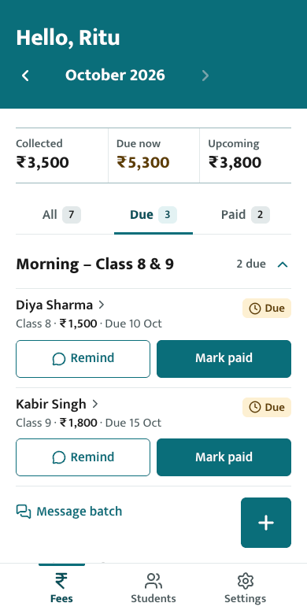
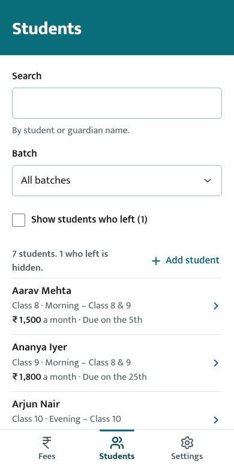
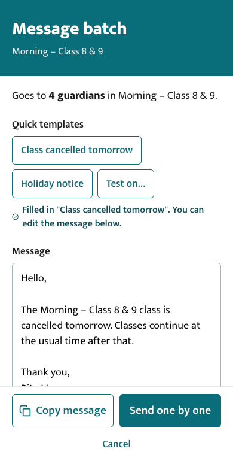
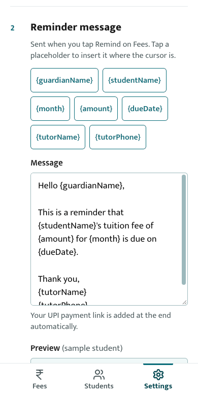

# Tuition App

A mobile-first web app for private tutors in India to keep track of students, batches and monthly fees, and to remind parents on WhatsApp.

It runs entirely in the browser. There's no account and no server: all data stays on the tutor's own phone, with a backup file to move or restore it.

<p align="center">
  
  
  
  
</p>

<p align="center"><sub>Fees · Students · Message batch · Settings (screenshots use made-up demo data)</sub></p>

## What it does

**Fees**
- See each month's fees by batch, with a Collected / Due now / Upcoming summary.
- Each student has a joining date and a fee due day. A month's fee shows as **Paid**, **Due** or **Upcoming**.
- Mark paid with one tap (with Undo).
- Send a WhatsApp reminder pre-filled with the amount, due date and a UPI payment link.
- **Message batch:** write one message (or start from a template) and send it to every guardian in a batch, one by one, or copy it for a WhatsApp group.

**Students**
- Search by student or guardian name, and filter by batch.
- Add, edit and delete students. Fees for a new student start from the month they joined.
- Mark a student as **left**: they drop off later months, but their fee history is kept.
- On Android Chrome, pick a guardian's number straight from the phone's contacts.
- Manage batches: add, rename, and delete (moving the students to another batch first).

**Settings**
- Your name, phone and UPI ID, with a ₹1 test link to check the UPI ID works.
- An editable reminder message with placeholders like `{studentName}` and `{dueDate}`, and a live preview.
- A default fee and due day for new students.
- Export and restore a JSON backup, and delete all data.

**Built for phones**
- One-handed layout with a bottom navigation and the main actions at thumb height.
- Can be installed to the home screen.
- Accessible: visible labels, errors linked to their fields, status messages announced to screen readers, keyboard support and 44px+ tap targets. Status is always shown as a word, never by colour alone.

## Getting started

You'll need Node.js 20.19+ or 22.12+ (what Vite requires).

```bash
npm install
npm run dev       # start the dev server at http://localhost:5173
npm run build     # type-check and build into dist/
npm run lint      # ESLint
npm run preview   # serve the production build locally
```

**To try it on your phone,** run `npx vite --host` and open the **Network** address it prints, with the phone on the same Wi-Fi as your computer.

The contact picker only works on a secure address (HTTPS or `localhost`). To test it on Android, either host the app on HTTPS or use Chrome's USB port forwarding (`chrome://inspect`) to open `localhost:5173` on the phone.

## Deploying

The build is a static site with no server and no URL routing, so `dist/` can be served from any static host: GitHub Pages, Netlify, Vercel or Cloudflare Pages. HTTPS is needed for the contact picker and for the browser's clipboard API.

## Tech stack

- React 19 and TypeScript, built with Vite
- Plain CSS with design tokens (no UI framework)
- [lucide-react](https://lucide.dev) icons and the [Mukta](https://fonts.google.com/specimen/Mukta) typeface
- Browser `localStorage` for data, with a versioned record and migrations

## Project structure

```
src/
  App.tsx            screen state, history navigation, saving
  screens/           Setup, Fees (Home), Students, Student form, Batches,
                     Message batch, Settings
  components/        shared UI: fields, bottom nav, tabs, toast, chapter band
  lib/               data model and validation, fee logic, messages, contacts
```

## Documentation

- [flow.md](flow.md): how the app fits together, screen by screen, and the data format
- [decisions.md](decisions.md): why things are built the way they are, with the alternatives considered
- [DESIGN.md](DESIGN.md): the visual design system
- [PRODUCT.md](PRODUCT.md): who the app is for and what's in scope

## Privacy

The app never sends data anywhere. Everything is stored in the browser on the device where it's used. Reminders and batch messages open WhatsApp with the text filled in, and the tutor sends them herself. A backup file holds guardians' names and phone numbers, so keep it somewhere safe.
